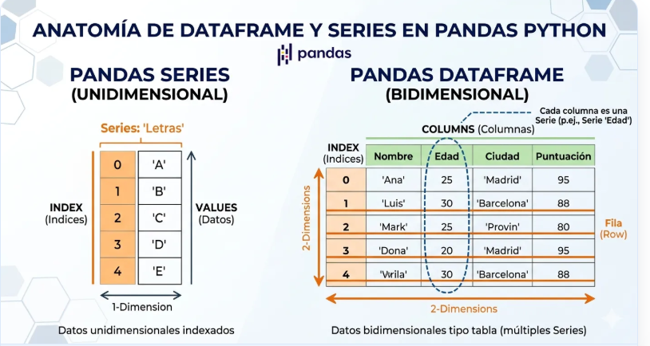
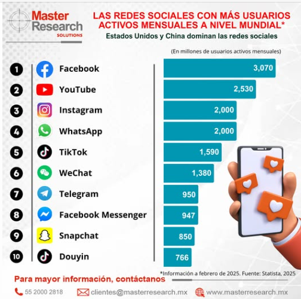
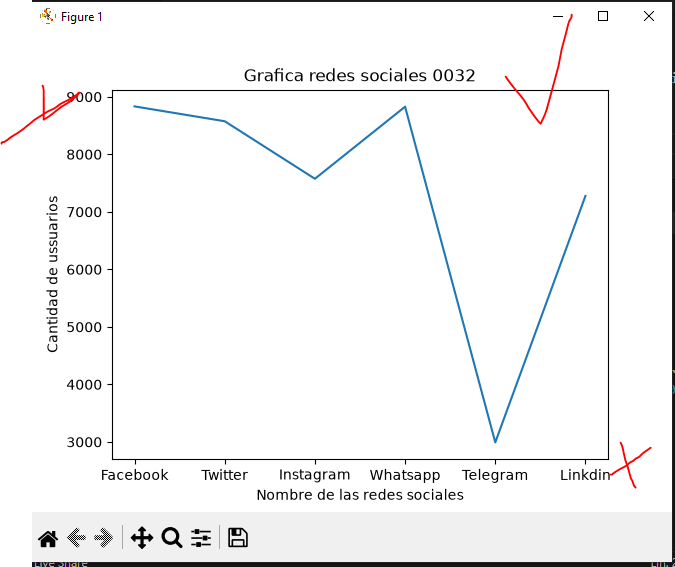
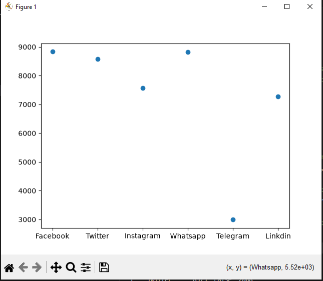
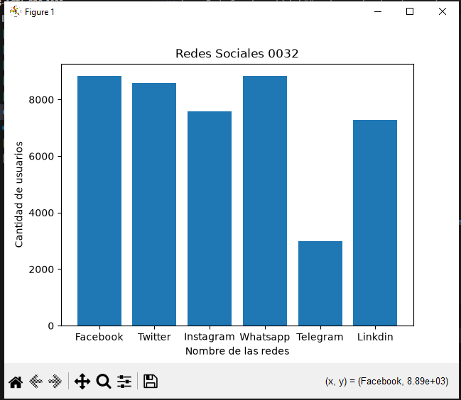
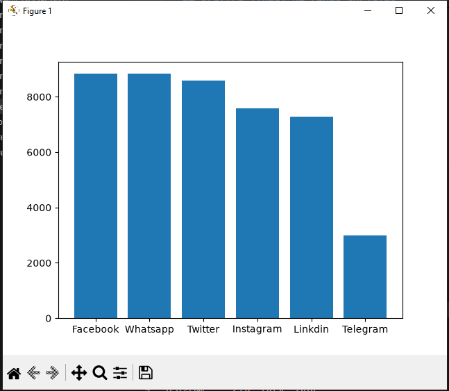
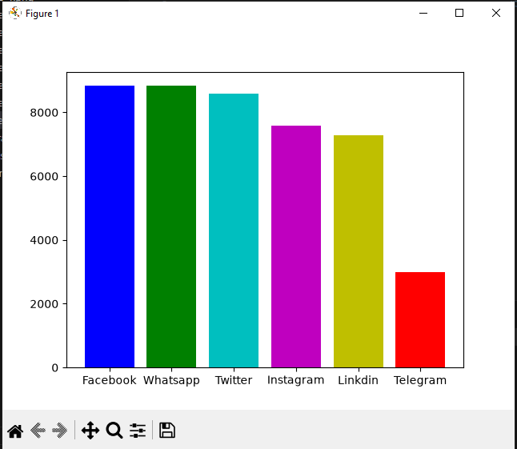
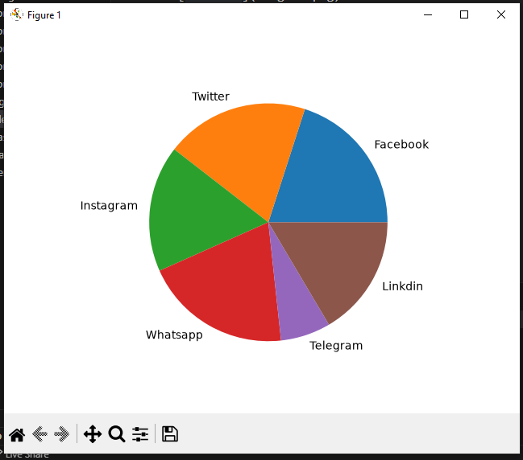

## dtaframe o marco de datos

## redes sociales a nivel mundial

## grafica lineal de redes sociales

## grafica puntos de redes sociales

## grafica de barras de redes sociales

 ## grafica de barras del mas grande al mas chico Decendente

 ## coloreando las graficas

 ## grafica de pastel o pie
 